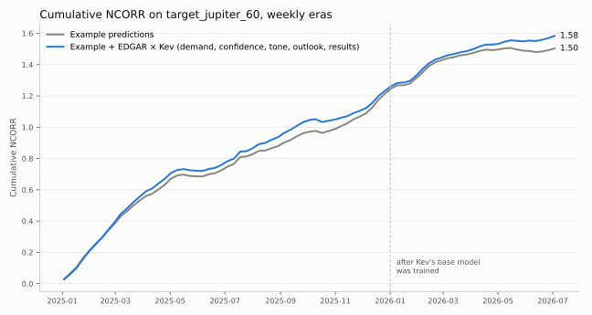

# Signals features from SEC earnings releases, scored by Kev

This example turns US companies' quarterly earnings releases on SEC EDGAR into five Numerai Signals
features. A local [Kev](https://github.com/jaredpalmer/kev) model reads each release and answers five
questions. Kev is open-weight, so nothing needs an API key. The answers are ranked within each date and cut
into five bins, 0–4, like the Signals features.

## Setup

Start a Kev server. The first run downloads about 9 GB. It runs on Apple Silicon with 32 GB or more, or on a
CUDA GPU.

```bash
git clone https://github.com/jaredpalmer/kev.git && cd kev
uv sync --extra serve
uv run --extra serve python -m kev.serve --run jaredpalmer/kev-4b@v1.0 --port 8009
```

Then, in this folder:

```bash
pip install -r requirements.txt
export SEC_USER_AGENT="Your Name you@example.com"  # SEC requires a contact for EDGAR downloads
```

## Run

```bash
python edgar_kev.py --start 2026-07-13 --tickers AAPL MSFT JPM       # a few companies, recent dates
python edgar_kev.py --start 2026-07-13                               # every US company in Signals
python edgar_kev.py --start 2004-08-23 --data train validation live  # all history, for training
```

The script writes `data/edgar_kev_features.parquet` with `numerai_ticker`, `date` and the five features.
Join it to any Signals file:

```python
features = pd.read_parquet("data/edgar_kev_features.parquet")
train = train.merge(features, on=["numerai_ticker", "date"], how="left")
```

Kev's answers are cached in `data/kev_scores.jsonl`, so a rerun only scores new filings.

## How it works

1. **Releases.** SEC's ticker list maps each US ticker to the company's CIK. The script keeps the 8-K filings
   that report Item 2.02, *Results of Operations*, and reads the press release (exhibit 99) without its
   numeric tables.
2. **Scores.** The first ~2,000 tokens of each release, with the company's name and tickers hidden, go to Kev
   with five Score questions in one request: results against a year earlier, guidance or outlook, tone,
   demand for the company's products, and management's confidence. Each answer is a probability-weighted
   level from 0 to 4.
3. **Point in time.** A release counts for a date only if it was filed on an earlier day, for at most 100 days.
4. **Features.** `feature_edgar_kev_results`, `_outlook`, `_tone`, `_demand` and `_confidence` are the scores
   ranked within each date into five bins, 0–4. Tickers without a recent release, including every non-US
   ticker, are NaN.

## Does it help?

We scored every US company's earnings releases filed from September 2024 to July 2026 (19,872 releases)
and added the five features to Numerai's validation example predictions at a small weight: the Gaussianized
example predictions plus 0.1 times each feature's Gaussianized rank within the date, with tickers that have
no recent release adding nothing. (The test used Kev's raw scores rather than the 0–4 bins.)



| 79 weekly eras, 2025-01 to 2026-07 | Example predictions | With the five features |
| --- | --- | --- |
| NCORR on `target_jupiter_60` | 0.0190 | 0.0201 |
| Sharpe of NCORR | 1.17 | 1.26 |
| Eras where the blend is higher | | 62% |

The gain is +0.0004 in 2025 and +0.0023 in 2026; Kev's base model was trained before 2026. It is small and
not yet statistically reliable (t ≈ 1.1 with overlapping targets), so treat it as a starting point.

```python
from scipy.stats import norm

def gauss(x):
    return pd.Series(norm.ppf((x.rank() - 0.5) / x.count()), index=x.index)

live = live.merge(features, on=["numerai_ticker", "date"], how="left")
live["signal"] = gauss(live["signal"])  # your own predictions
for f in [c for c in features if c.startswith("feature_edgar_kev_")]:
    live["signal"] += 0.1 * gauss(live[f]).fillna(0)
```

For historical files, apply `gauss` within each date.

## Limits

- **US only.** EDGAR covers SEC filers, about a third of the Signals universe.
- **Current tickers.** SEC's ticker list has no history. Further back, delisted and renamed companies are
  missing, which biases a backtest toward survivors.
- **Model knowledge.** Kev's Qwen3.5 base was trained before 2026. For older releases it may know what
  happened next, so backtests can look better than live results. Hiding names removes some clues, not all.
- **Accuracy.** Kev was not trained or evaluated on financial text. Check its answers on releases you know.
